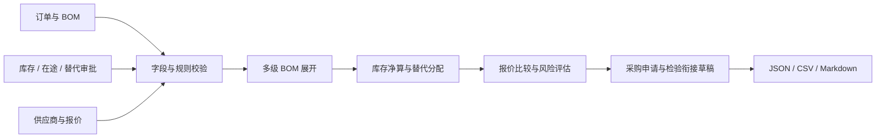

# 架构

`KittingPlanner.run()` 接受两个独立对象：构造时传入规划配置，运行时传入业务快照。引擎复制输入并执行确定性计算，不读写外部业务系统。

| 模块 | 职责 |
|---|---|
| `engine.py` | 校验、BOM 展开、齐料净算、替代料分配、报价比较、草稿与审计记录 |
| `errors.py` | 稳定错误码 |
| `reporting.py` | 本地文件导出 |
| `cli.py` | 输入路径、验证、计划和审计命令 |

接入其他系统时，由调用方将数据转换为输入约定，再调用 Python API 或命令行。接口调用、身份验证和跨订单库存预留属于调用方职责。此仓库没有预置企业服务地址、数据库连接或业务凭据。

测试包含独立手算、输入异常、库存重复占用、审批数量、报价淘汰、记录篡改与安装后的命令行运行。示例和测试全部使用合成数据。
